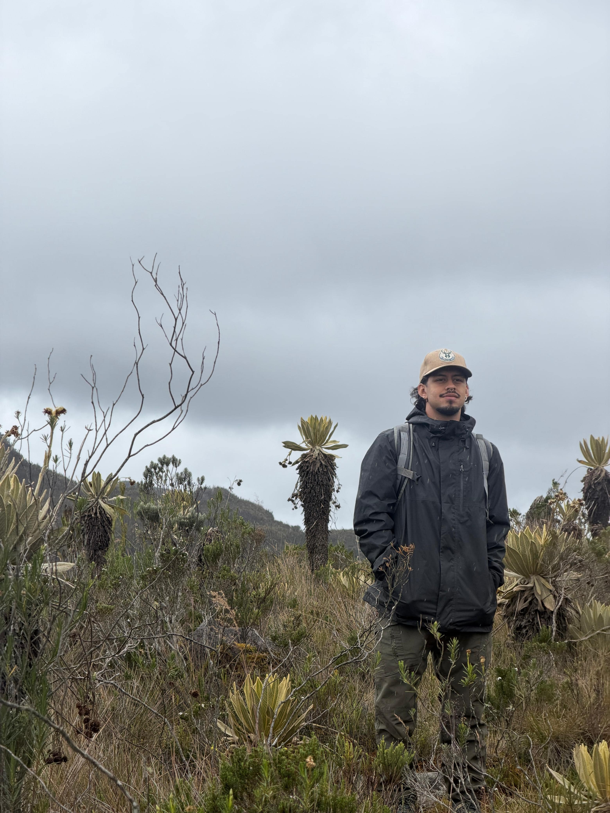

::: {.profile-header}
::: {.profile-left}
{.profile-photo-large}

::: {.profile-links}
[✉](mailto:alejandro.jaramillo@posgrado.ecologia.edu.mx)
:::
:::

::: {.profile-right}
**MSc Student**  
Instituto de Ecología, A.C. (INECOL)

*Interests:* [Community ecology]{.profile-tag} [Numerical ecology]{.profile-tag} [Macroecology]{.profile-tag} [Plants]{.profile-tag}

Biologist from the Universidad de Antioquia.
Interested in the ecology of tropical plants.
He studies the contribution of plant-bird interactions to the maintenance of their diversity along geographical and environmental gradients.

### Education

- **BSc** — Universidad de Antioquia, Colombia (2025)
:::
:::

::: {.profile-back}
[← Back to Team](../equipo.html)
:::