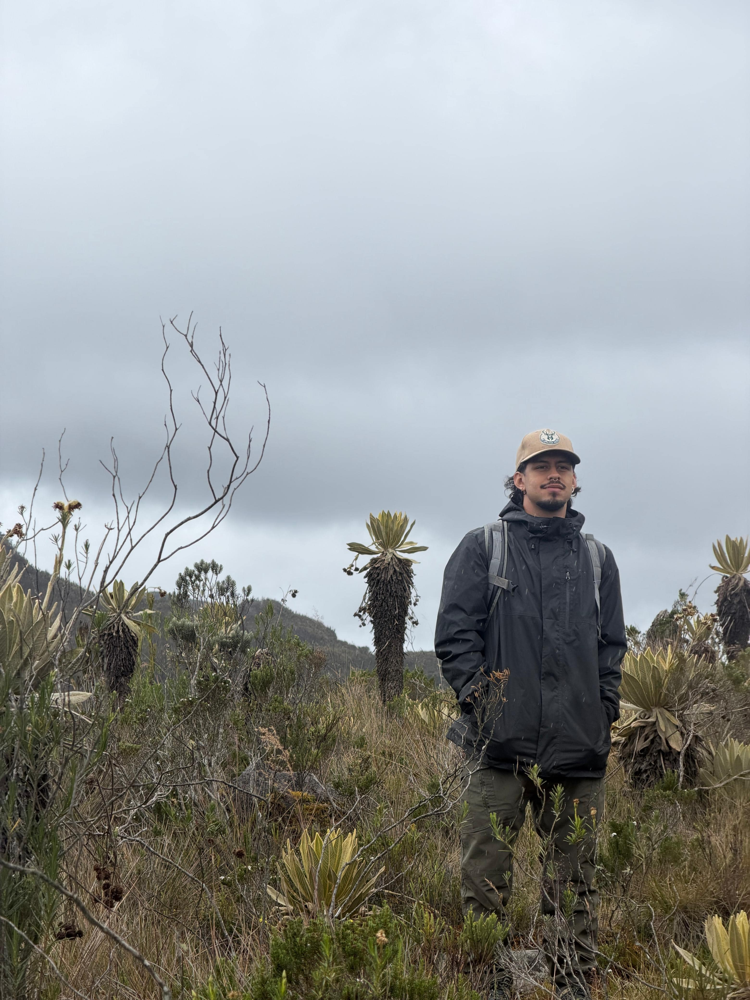

::: {.profile-header}
::: {.profile-left}
{.profile-photo-large}

::: {.profile-links}
[✉](mailto:alejandro.jaramillo@posgrado.ecologia.edu.mx)
:::
:::

::: {.profile-right}
**Estudiante de Maestría**  
Instituto de Ecología, A.C. (INECOL)

*Intereses:* [Ecología de comunidades]{.profile-tag} [Ecología numérica]{.profile-tag} [Macroecología]{.profile-tag} [Plantas]{.profile-tag}

Biólogo de la Universidad de Antioquia. 
Interesado en la ecología de plantas tropicales.
Estudia la contribución de las interacciones planta-ave en el mantenimiento de su diversidad a lo largo de gradientes geográficos y ambientales.

### Educación

- **Pregrado** — Universidad de Antioquia, Colombia (2025)
:::
:::

::: {.profile-back}
[← Regresar al Equipo](../equipo.html)
:::